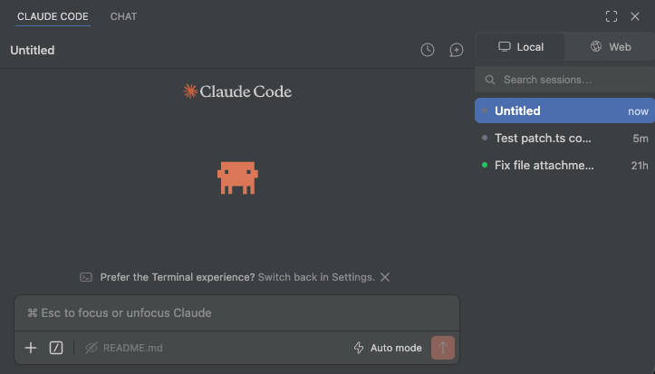

#  CCE Patch — Claude Code Extension Patcher

[](LICENSE)
[](#requirements)
[](#multi-editor-support)
[](#requirements)
[](#)

> **Persistent sessions sidebar + live status dots for the Claude Code VS Code extension.**

---

## Features

### Persistent Sessions Sidebar

The sessions list becomes a **permanent sidebar panel** (80/20 split) instead of a floating dropdown. No more opening and closing — all your sessions are always visible alongside the chat.

### Live Session Status Dots

Each session displays a colored status indicator:

| Dot | Status | Meaning |
|-----|--------|---------|
|  | **Done** | Task completed, not yet viewed |
|  | **Running** | Task is actively executing (pulsing) |
|  | **Waiting** | Needs user input (pulsing) |
|  | **Seen** | Task completed and already viewed |

### Screenshot



### Include Selection Default Off

The "Include Selection" toggle in the chat input defaults to **off** instead of on, preventing accidental context injection.

### Drafts Kept Per Session

Start typing in a session, switch to another one, come back — your **text, `@`-mentions and attachments are still there**, with the caret at the end. Works for new and existing sessions alike; sending the message clears the draft. The text of existing sessions also survives a window reload (kept in the webview's local storage for 30 days); attachments are kept for as long as the window is open. Since extension 2.1.300 the extension itself keeps the text and attachments while you switch sessions; the patch adds the `@`-mentions and the reload persistence.

### Claude Commit Messages

A **Generate Commit Message with Claude** button for the Source Control view (a small companion extension in [`claude-commit/`](claude-commit/), which `patch.ts` installs into the same editors; see [Usage](#claude-commit-message-button)). It does exactly what the built-in ✨ button does: it reads the staged changes (or all changes when nothing is staged) and your last commit messages, follows your `github.copilot.chat.commitMessageGeneration.instructions`, and fills in the commit message box. The message comes from **Claude Haiku through your Claude Code login**, typically in 2–4 seconds. Click the button again while it runs to stop it.

### Phone Remote

A **Connection** tab next to **Local** and **Web** in the sessions panel puts this Mac on your [Tailscale](https://tailscale.com) network, so **CCE Remote**, a web app you add to your phone's home screen (in [`remote-app/`](remote-app/)), can follow and drive your Claude Code sessions: every open VS Code window shows up as a project with its sessions and their live status, and from the phone you can read a session as it streams, answer permission prompts, questions and plan approvals, send messages (photos too), stop a turn, and start new sessions, which open where you keep Claude Code in VS Code (the sidebar or an editor tab).

- **Off until you turn it on.** Nothing listens until you click **Connect with Tailscale**. Then it stays on (every window joins in, and it comes back when VS Code starts again) until you click **Disconnect**. Closing the last remaining VS Code window on its own turns `tailscale serve` off until the next start. Quitting VS Code with two or more windows open leaves serve on (the windows stop together, so none of them is the last one), and so does a crash: until VS Code starts again, you click **Disconnect**, or you run `bun run patch.ts --revert`.
- **Only your phone, only inside your tailnet.** The Mac is reachable through `tailscale serve` (HTTPS on its Tailscale name, port 47821), never through Tailscale Funnel or a public address. A phone has to belong to the Mac's own Tailscale user and is paired once with a one-time code (QR code or link) from the Connection tab; it then has its own token, which **Paired devices** can revoke.
- **HTTPS certificates.** The phone app runs over HTTPS, so the Mac needs a Tailscale HTTPS certificate: turn on HTTPS certificates for your tailnet once (the tab links to the page). That publishes the Mac's Tailscale name (`<machine>.<tailnet>.ts.net`) in public certificate logs, so rename the machine in Tailscale first if the name is personal.
- **Phone app address.** Where you host the web app; it goes into the pairing link and QR code. Whoever controls that host can act as your paired phone, so host it somewhere you trust.
- **On a Mac you share with other accounts, click Disconnect before you quit VS Code or revert the patch.** `tailscale serve` goes off by itself only when you close the last remaining VS Code window on its own. Quitting VS Code with two or more windows open, a crash or a force quit leaves it on until VS Code starts again. While serve is on and no VS Code window holds port 47821, a program of another account could take the port and receive your phone's next connection, its device token included.

**Slash commands.** Typing `/` in the phone's message field lists the window's slash commands: the Claude Code commands VS Code's `/` menu shows, meaning built-ins, your own and the project's commands, skills, and plugin and MCP commands. Tapping one runs it in that session in VS Code, as if you had typed it there.
- **Arguments.** A command that takes arguments can be put in the field to finish first.
- **Text instead of dialogs.** For `/context`, `/usage`, `/model`, `/mcp`, `/config` and `/settings`, VS Code opens its own dialog on the Mac; from the phone, Claude Code answers in text.
- **Settings.** A model, effort or setting changed from the phone applies to the running session, but VS Code's pickers don't show it, and new sessions start from VS Code's settings.
- **`/clear`, `/reset` and `/new`:** the phone follows into the new session.

The Mac reads the list from what the extension already holds and never starts anything to get it.

**Notifications.** With CCE Remote added to the iPhone's home screen and notifications turned on there, this Mac can send a push when a Claude Code session waits for you (a question, a permission prompt, a plan or a dialog) or finishes a turn; tapping one opens that session in the app. It needs remote access on, a VS Code window open and the Mac awake. Payloads are end-to-end encrypted (RFC 8291), so the push service (Apple's, or the phone's browser vendor's) sees only ciphertext and routing metadata, never session content. The app can limit pushes to when you are away from the Mac and can hide the details.

The bridge behind it (in [`remote-bridge/`](remote-bridge/)) is copied into the extension and runs inside it, with no dependencies. To patch without it, add `--no-remote`.

### Claude in Chrome Auto-Accept

When Claude uses Chrome from VS Code, it asks twice: once for the browser tool, and once for each new site ("Claude in Chrome requires permission"). In auto mode, a `PermissionRequest` hook can't approve either one. The **Claude in Chrome** section at the bottom of the Connection tab has an opt-in switch, **Turn on auto-accept**, that answers the routine ones for you.

- **Off until you turn it on.** It's one switch for all your patched editor windows, and it stays as you set it across restarts (`chromeAutoAccept` in `~/.cce-remote/state.json`). It works with the phone remote on or off. Only an editor window can turn it on; the phone can't.
- **Only routine Claude in Chrome prompts.** It answers prompts for Claude in Chrome's tools (`mcp__claude-in-chrome__*`), as **Allow** would.
  - A site card gets "always allow this site" for the session, so each site asks at most once per session.
  - A tool prompt gets a plain allow, which writes no settings file and changes no mode.
  - Every other prompt (other tools, questions, plans, dialogs) still reaches you, in VS Code and on the phone.
- **Flagged prompts still ask you.** Claude Code marks some prompts for a person and pre-selects No: actions the auto-mode safety check blocked or couldn't judge, file uploads, and prompts a hook asks for. The switch leaves these to you.
- **The risk.** While it's on, a web page Claude reads can steer Claude into acting on that page or on other sites, and you won't see a prompt (prompt injection). Turn it on only for browsing you would approve anyway.
- **Turning it off.** Every window stops answering at once. A site already allowed in a session stays allowed in that session, as if you had picked "always allow this site" yourself. `--revert` turns the switch off too.
- **The log.** Claude Code's output channel logs each answer (`Claude in Chrome auto-accept allowed <tool>`). It also logs when a window starts with the switch on, and every time the switch is turned on or off.

### Multi-Editor Support

Automatically detects and patches **all installed editors** in a single run:

| Editor | Extension Path |
|--------|---------------|
| VS Code Insiders | `~/.vscode-insiders/extensions/` |
| VS Code | `~/.vscode/extensions/` |
| Cursor | `~/.cursor/extensions/` |
| VSCodium | `~/.vscodium/extensions/` |

---

## Requirements

- **macOS, Linux, Windows, or WSL** (standard VS Code extension paths)
- **Claude Code extension** installed in at least one supported editor
- One of the following runtimes:
  - [Bun](https://bun.sh) (recommended — zero config)
  - [Node.js](https://nodejs.org) 18+ with `tsx`

---

## Usage

### With Bun (recommended)

```bash
# Apply patch to all detected editors (also installs the Claude commit message button)
bun run patch.ts

# Revert all editors to original (also removes the button)
bun run patch.ts --revert

# Patch without touching the commit message button
bun run patch.ts --no-commit-button

# Patch without the phone remote (no Connection tab, no bridge in the extension)
bun run patch.ts --no-remote
```

### With npm / Node.js

```bash
# Install tsx globally (one-time)
npm install -g tsx

# Apply patch
tsx patch.ts

# Revert
tsx patch.ts --revert
```

Or without global install using `npx`:

```bash
npx tsx patch.ts
npx tsx patch.ts --revert
```

### After Patching

Restart each patched editor to apply changes:

- **VS Code / Insiders**: `Cmd+Shift+P` (or `Ctrl+Shift+P`) → `Reload Window`
- **Cursor**: `Cmd+Shift+P` → `Reload Window`

### Claude Commit Message Button

`bun run patch.ts` installs it into every editor it patches, and `bun run patch.ts --revert` removes it again. To patch without it, add `--no-commit-button`. Reruns skip editors that already have the current version. To manage only the button:

```bash
# Install into every editor that has Claude Code (or name them: insiders, code, cursor, codium)
bun run claude-commit/install.ts
bun run claude-commit/install.ts insiders

# Remove it again
bun run claude-commit/install.ts --uninstall
```

The installer packs the extension, installs it with the editor's command-line tool (no reload needed), and adds it to `"enable-proposed-api"` in the editor's `argv.json`:

- **Right after installing**, the button (the Claude icon) sits in the title bar of the **Changes** view, left of ✓ and ↻. Like those, it shows while the pointer is over the view.
- **After the next full restart** of the editor (quit and reopen, not just Reload Window), it moves into the commit message box, where the ✨ button is. VS Code only lets extensions it allows put buttons there, and `argv.json` is read once at startup. When both buttons exist, the box shows one and puts the other behind the ⌄ arrow next to it. Pick **Generate Commit Message with Claude** there once and it stays the one shown.

Settings: `claudeCommit.model` (`haiku` by default, the fastest; `sonnet`, `opus` or a full model name also work) and `claudeCommit.claudePath` (by default the `claude` bundled with the Claude Code extension, then `claude` on `PATH`). Each call is logged in the **Claude Commit Message** output channel.

---

## How It Works

The patcher modifies three files inside each editor's Claude Code extension directory, and adds one folder:

| File | What Changes |
|------|-------------|
| `extension.js` | Enables `sessionsListEnabled` and `primaryEditorEnabled` feature flags, starts the CLI with `--effort max` unless another level is set, hands each window's webview provider to the phone remote bridge |
| `webview/index.js` | Removes dropdown close behavior, injects status dot elements, defaults "Include Selection" to off, keeps each session's draft, adds the Connection tab |
| `webview/index.css` | Restyles the dropdown as a fixed sidebar panel, adds status dot styles with pulse animations, styles the Connection tab |
| `cce-remote/` (new) | The phone remote bridge, copied from `remote-bridge/` |

### Safety

- **Backups** are created automatically on first run (`.bak` files alongside each original)
- **Revert** restores the exact original files from backup and deletes `cce-remote/`. If the phone remote is on, it also turns it off and turns `tailscale serve` off for its port (when Tailscale doesn't answer within 20 s, it prints the command to run). It looks at serve only while remote access is on: a serve left on after remote access was turned off (a turn-off that failed, which the Connection tab reports) survives a revert, so run `tailscale serve --https=47821 off` yourself. It also turns the Claude in Chrome switch off. `~/.cce-remote/` stays, with your paired phones and the phone app address; delete it to forget them
- **Idempotent** — re-running the patch always reads from the original backup, so it's safe to run multiple times
- **No network access** — the script only reads and writes local files (and `--revert` asks the local Tailscale CLI to turn `tailscale serve` off)
- **Fails closed** — when an extension update moves code the patch hooks into, that part is skipped and reported as `FAIL`; the rest of the extension keeps working. The phone remote listens (on 127.0.0.1:47821 only) only while it's turned on

---

## Troubleshooting

| Issue | Solution |
|-------|---------|
| "Claude Code extension not found" | Ensure the extension is installed in at least one supported editor |
| Patch applied but no visible changes | Restart the editor (`Reload Window`) |
| Extension updated and patch broke | Run the patch again — it will create fresh backups and re-patch |
| Want to start fresh | Run `--revert` first, then delete any `.bak` files, then re-patch |
| Claude commit button only in the "Changes" title bar | Quit and reopen the editor once; `argv.json` changes need a full restart |
| Claude commit button says Claude Code isn't logged in | Run `claude` in a terminal and log in, or set `claudeCommit.claudePath` |
| Connection tab says the bridge isn't running | Run the patch again from a complete checkout (the patch output must show `ok   remote bridge files`), then `Reload Window` |
| Claude in Chrome still asks with auto-accept on | `Reload Window` in every window after patching (a window that wasn't reloaded runs the old bridge, whose Connection tab has no Claude in Chrome section). Prompts that Claude Code flags for a person (No pre-selected) still ask by design, and so do other tools' prompts |
| Connection tab: "HTTPS certificates are off" | Click **Turn on HTTPS** and enable HTTPS certificates for your tailnet, then **Connect with Tailscale** again |
| The phone can't reach the Mac | Turn Tailscale on on the phone, signed in as the same Tailscale user as the Mac |

---

## License

MIT
