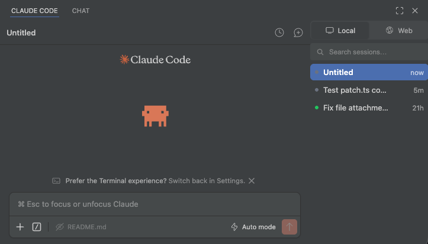

#  CCE Patch — Claude Code Extension Patcher

[](LICENSE)
[](#requirements)
[](#multi-editor-support)
[](#requirements)
[](#)

> **Persistent sessions sidebar + live status dots for the Claude Code VS Code extension.**

---

## Features

### Persistent Sessions Sidebar

The sessions list becomes a **permanent sidebar panel** (80/20 split) instead of a floating dropdown. No more opening and closing — all your sessions are always visible alongside the chat.

### Live Session Status Dots

Each session displays a colored status indicator:

| Dot | Status | Meaning |
|-----|--------|---------|
|  | **Done** | Task completed, not yet viewed |
|  | **Running** | Task is actively executing (pulsing) |
|  | **Waiting** | Needs user input (pulsing) |
|  | **Seen** | Task completed and already viewed |

### Screenshot



### Include Selection Default Off

The "Include Selection" toggle in the chat input defaults to **off** instead of on, preventing accidental context injection.

### Drafts Kept Per Session

Start typing in a session, switch to another one, come back — your **text, `@`-mentions and attachments are still there**, with the caret at the end. Works for new and existing sessions alike; sending the message clears the draft. The text of existing sessions also survives a window reload (kept in the webview's local storage for 30 days); attachments are kept for as long as the window is open. Since extension 2.1.300 the extension itself keeps the text and attachments while you switch sessions; the patch adds the `@`-mentions and the reload persistence.

### Claude Commit Messages

A **Generate Commit Message with Claude** button for the Source Control view (a small companion extension in [`claude-commit/`](claude-commit/), which `patch.ts` installs into the same editors; see [Usage](#claude-commit-message-button)). It does exactly what the built-in ✨ button does: it reads the staged changes (or all changes when nothing is staged) and your last commit messages, follows your `github.copilot.chat.commitMessageGeneration.instructions`, and fills in the commit message box. The message comes from **Claude Haiku through your Claude Code login**, typically in 2–4 seconds. Click the button again while it runs to stop it.

### Multi-Editor Support

Automatically detects and patches **all installed editors** in a single run:

| Editor | Extension Path |
|--------|---------------|
| VS Code Insiders | `~/.vscode-insiders/extensions/` |
| VS Code | `~/.vscode/extensions/` |
| Cursor | `~/.cursor/extensions/` |
| VSCodium | `~/.vscodium/extensions/` |

---

## Requirements

- **macOS, Linux, or WSL** (standard VS Code extension paths)
- **Claude Code extension** installed in at least one supported editor
- One of the following runtimes:
  - [Bun](https://bun.sh) (recommended — zero config)
  - [Node.js](https://nodejs.org) 18+ with `tsx`

---

## Usage

### With Bun (recommended)

```bash
# Apply patch to all detected editors (also installs the Claude commit message button)
bun run patch.ts

# Revert all editors to original (also removes the button)
bun run patch.ts --revert

# Patch without touching the commit message button
bun run patch.ts --no-commit-button
```

### With npm / Node.js

```bash
# Install tsx globally (one-time)
npm install -g tsx

# Apply patch
tsx patch.ts

# Revert
tsx patch.ts --revert
```

Or without global install using `npx`:

```bash
npx tsx patch.ts
npx tsx patch.ts --revert
```

### After Patching

Restart each patched editor to apply changes:

- **VS Code / Insiders**: `Cmd+Shift+P` (or `Ctrl+Shift+P`) → `Reload Window`
- **Cursor**: `Cmd+Shift+P` → `Reload Window`

### Claude Commit Message Button

`bun run patch.ts` installs it into every editor it patches, and `bun run patch.ts --revert` removes it again. To patch without it, add `--no-commit-button`. Reruns skip editors that already have the current version. To manage only the button:

```bash
# Install into every editor that has Claude Code (or name them: insiders, code, cursor, codium)
bun run claude-commit/install.ts
bun run claude-commit/install.ts insiders

# Remove it again
bun run claude-commit/install.ts --uninstall
```

The installer packs the extension, installs it with the editor's command-line tool (no reload needed), and adds it to `"enable-proposed-api"` in the editor's `argv.json`:

- **Right after installing**, the button (the Claude icon) sits in the title bar of the **Changes** view, left of ✓ and ↻. Like those, it shows while the pointer is over the view.
- **After the next full restart** of the editor (quit and reopen, not just Reload Window), it moves into the commit message box, where the ✨ button is. VS Code only lets extensions it allows put buttons there, and `argv.json` is read once at startup. When both buttons exist, the box shows one and puts the other behind the ⌄ arrow next to it. Pick **Generate Commit Message with Claude** there once and it stays the one shown.

Settings: `claudeCommit.model` (`haiku` by default, the fastest; `sonnet`, `opus` or a full model name also work) and `claudeCommit.claudePath` (by default the `claude` bundled with the Claude Code extension, then `claude` on `PATH`). Each call is logged in the **Claude Commit Message** output channel.

---

## How It Works

The patcher modifies three files inside each editor's Claude Code extension directory:

| File | What Changes |
|------|-------------|
| `extension.js` | Enables `sessionsListEnabled` and `primaryEditorEnabled` feature flags, starts the CLI with `--effort max` unless another level is set |
| `webview/index.js` | Removes dropdown close behavior, injects status dot elements, defaults "Include Selection" to off, keeps each session's draft |
| `webview/index.css` | Restyles the dropdown as a fixed sidebar panel, adds status dot styles with pulse animations |

### Safety

- **Backups** are created automatically on first run (`.bak` files alongside each original)
- **Revert** restores the exact original files from backup
- **Idempotent** — re-running the patch always reads from the original backup, so it's safe to run multiple times
- **No network access** — the script only reads and writes local files

---

## Troubleshooting

| Issue | Solution |
|-------|---------|
| "Claude Code extension not found" | Ensure the extension is installed in at least one supported editor |
| Patch applied but no visible changes | Restart the editor (`Reload Window`) |
| Extension updated and patch broke | Run the patch again — it will create fresh backups and re-patch |
| Want to start fresh | Run `--revert` first, then delete any `.bak` files, then re-patch |
| Claude commit button only in the "Changes" title bar | Quit and reopen the editor once; `argv.json` changes need a full restart |
| Claude commit button says Claude Code isn't logged in | Run `claude` in a terminal and log in, or set `claudeCommit.claudePath` |

---

## License

MIT
